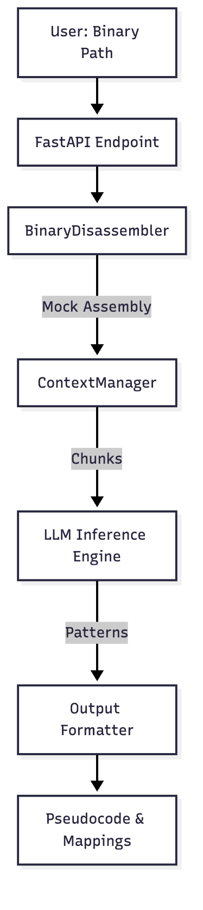
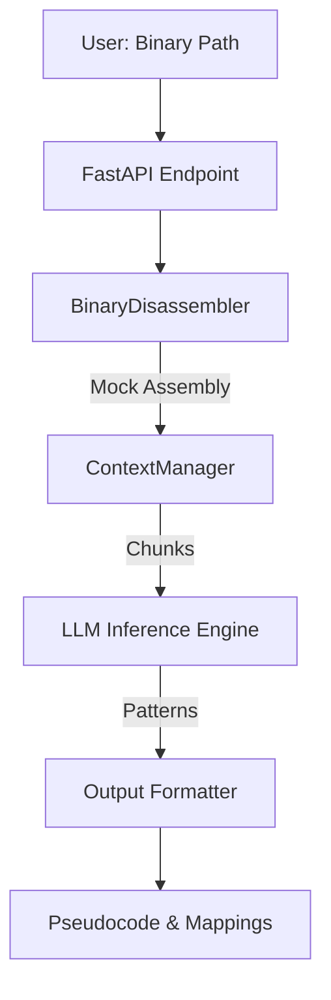

# Binomind MVP

A small, working Python MVP inspired by 500B Tokens Later.

## Core Job
Generate readable pseudocode and logical understanding from large, complex, or obfuscated binaries by leveraging massive context windows for cross-referencing.

## Workflow
1. User provides binary file path.
2. System runs local disassembler (simulated) to extract assembly.
3. System chunks assembly into context-window-friendly segments.
4. LLM analyzes segments for obfuscation patterns and logic.
5. System outputs synthesized pseudocode and key function mappings.

## Components
- **Local LLM Inference Engine**: Simulates LLaMA.cpp with extended context.
- **Binary Disassembler**: Wrapper for Ghidra/Radare2 (mocked).
- **Context Manager**: Handles chunking and reassembly.
- **Output Formatter**: Generates pseudocode.

## Installation
```bash
pip install -r requirements.txt
```

## Running
```bash
uvicorn main:app --reload
```

## Demo
```bash
python -c "from main import demo; demo()"
```

## Tests
```bash
pytest -q
```

## Architecture



<details>
<summary>Mermaid source</summary>



</details>
